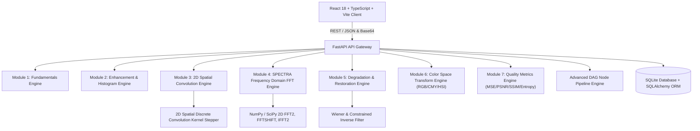

# PIXELRESCUE
## Advanced Image Processing, Restoration & Frequency Analysis Platform

PIXELRESCUE is an advanced scientific web application and interactive laboratory for **Digital Image Processing (DIP)**. Built for academic rigor and engineering excellence, it demonstrates actual mathematical image processing algorithms with full transparency: every algorithm exposes its governing equations, parameters, intermediate tensors, and objective quality metrics.

---

## 🏛 Architecture Overview



---

## 📚 Digital Image Processing Syllabus Mapping

PIXELRESCUE strictly adheres to the standard academic curriculum based on **Rafael C. Gonzalez & Richard E. Woods, *Digital Image Processing* (4th Edition)**:

| Module | DIP Syllabus Topic | Gonzalez & Woods Reference | Mathematical Concepts Implemented |
| :--- | :--- | :--- | :--- |
| **Module 1** | Digital Image Fundamentals | Chapter 2 (Sections 2.3 - 2.5) | Spatial Sampling, Aliasing, Intensity Quantization, False Contouring, Euclidean / City-Block ($D_4$) / Chessboard ($D_8$) metrics, 4-neighbor & 8-neighbor connectivity |
| **Module 2** | Spatial Intensity Transforms & Histogram Processing | Chapter 3 (Sections 3.1 - 3.3) | Negative, Logarithmic ($c \ln(1+r)$), Power-law Gamma ($c r^\gamma$), Contrast stretching, Histogram Equalization ($s_k = (L-1)\sum p_r(r_j)$), Histogram Specification / Matching |
| **Module 3** | Spatial Filtering & 2D Convolution | Chapter 3 (Sections 3.4 - 3.6) | Discrete 2D Spatial Convolution, Box Mean, Gaussian smoothing, Median rank filter, Laplacian ($\nabla^2 f$), Unsharp Masking, High-Boost ($k > 1$), Sobel & Prewitt gradients |
| **Module 4** | Frequency Domain Processing (SPECTRA) | Chapter 4 (Sections 4.5 - 4.9) | 2D Discrete Fourier Transform ($F(u,v)$), Frequency Centering, Magnitude Spectrum, Phase Spectrum, Ideal LPF/HPF (Gibbs ringing), Butterworth LPF/HPF, Gaussian LPF/HPF (zero-ringing), Notch Rejection |
| **Module 5** | Image Restoration & Degradation Modeling | Chapter 5 (Sections 5.2 - 5.8) | Degradation model $g = h * f + \eta$, Gaussian / Salt-and-Pepper / Periodic noise, Motion blur PSF ($L, \theta$), Direct Inverse Filtering, Wiener Filter (MMSE $S_\eta / S_f$), Restoration Challenge |
| **Module 6** | Color Image Processing | Chapter 6 (Sections 6.1 - 6.6) | RGB additive primaries, CMY subtractive primaries, HSI trigonometric forward & inverse conversion, Hue shifting, Saturation scaling, Intensity decoupling, Pseudo-color intensity slicing |
| **Module 7** | Objective Image Quality Assessment | Chapter 8 & 11 | Mean Squared Error (MSE), Peak Signal-to-Noise Ratio (PSNR dB), Structural Similarity Index (SSIM), Shannon Information Entropy ($-\sum p_i \log_2 p_i$), Statistical Histogram distances |
| **Advanced** | Visual Node-based Processing Pipeline | Multi-stage DIP Pipelines | Directed Acyclic Graph (DAG) topological evaluation, per-node intermediate tensor previews, end-to-end execution logging |

---

## 🚀 Key Modules & Capabilities

### 1. Image Fundamentals Lab
- **Interactive Pixel Inspector**: Inspect exact $(x, y)$ coordinates, RGB, Hex, normalized float values, and a $3\times3$ or $5\times5$ neighborhood window.
- **Sampling Simulation**: Sliders downsample spatial grid by factors from $1\times$ to $32\times$, showing pixelation and aliasing artifacts under nearest-neighbor and bilinear interpolation.
- **Quantization Simulation**: Reduce continuous intensities from 256 levels down to $2$ levels (1-bit), visibly illustrating the false contouring effect.
- **Distance Metrics**: Click any two coordinates to simultaneously compute and visualize Euclidean ($D_e$), City-block ($D_4$), and Chessboard ($D_8$) distances.
- **Connectivity Analyzer**: Floodfill comparison showing the difference between 4-connected and 8-connected components from a chosen seed point.

### 2. Enhancement Studio & Histogram Laboratory
- **Point Processing**: Negative, Log, Inverse-log, Gamma ($\gamma$), Piecewise linear contrast stretching ($[r_1, s_1] \to [r_2, s_2]$), and Global/Adaptive thresholding.
- **256-Bin Histogram with PDF/CDF**: Live probability density and cumulative distribution function calculation.
- **Mathematical Histogram Equalization**: Lookup table generation maximizing global entropy and dynamic range.
- **Histogram Matching / Specification**: Maps image distribution to Gaussian, Uniform, or reference target images.

### 3. Spatial Filtering Lab & Convolution Math Stepper
- **Smoothing Filters**: Box Mean, Gaussian ($2\text{D isotropic } \sigma$), Weighted Average, Median, Min, Max.
- **Sharpening & Edges**: 4-neighbor & 8-neighbor Laplacian, Unsharp Masking, High-Boost ($k$), Sobel X/Y, Prewitt X/Y, Gradient Magnitude $M(x,y)$.
- **Interactive Kernel Math Stepper**: Click any pixel on the image to see:
  1. Neighborhood Image Patch $f(x+s, y+t)$
  2. Filter Kernel Matrix $w(s,t)$
  3. Element-wise product matrix $w \odot f$
  4. Summation $\sum \sum$ and final output pixel value $g(x,y)$
  5. Interactive visual overlay highlighting the neighborhood box on the image canvas.

### 4. SPECTRA: Flagship Frequency Domain Laboratory
- **Four Synchronized Visualization Panels**:
  - **Panel 1**: Original spatial-domain image $f(x,y)$
  - **Panel 2**: Centered Fourier log-magnitude spectrum $\ln(1 + |F(u,v)|)$
  - **Panel 3**: 2D Frequency filter mask $H(u,v)$ in false color
  - **Panel 4**: Reconstructed output image $g(x,y) = \text{Re}(\text{IFFT2}[F \cdot H])$
- **Filter Families**: Ideal, Butterworth (order $n$), Gaussian, and Notch Rejection.
- **1D Radial Frequency Profile**: Interactive plot demonstrating filter decay rate against cutoff radius $D_0$.

### 5. Image Restoration Engine & Restoration Challenge
- **Degradation Models**: Linear Motion Blur PSF ($L, \theta$), Atmospheric Gaussian Blur, Gaussian noise, Salt-and-Pepper impulse noise, Sinusoidal periodic interference.
- **Restoration Methods**: Arithmetic Mean, Geometric Mean, Median, Constrained Direct Inverse, Wiener Deconvolution (MMSE with regularizer $K$).
- **Restoration Challenge**: Automatically runs Clean Ground Truth $\to$ Degraded $\to$ Restored, providing an objective Scorecard with $\Delta \text{PSNR}$ (dB) and SSIM improvements.

### 6. Color Processing Laboratory
- **Full Gonzalez & Woods HSI Formulations**: Exact trigonometric conversions between RGB and HSI across all three $120^\circ$ sectors.
- **Channel Decomposition**: R, G, B, C, M, Y, and H, S, I channels displayed both in native color and grayscale intensity.
- **Independent Color Manipulation**: Hue shift ($0^\circ - 360^\circ$), Saturation scaling, and Intensity scaling.
- **Pseudo-Color Engine**: Jet, Viridis, Plasma, Inferno, Turbo, Bone, Rainbow colormaps with continuous rendering or discrete intensity slicing bands.

### 7. Image Quality Analysis
- **Objective Metrics**: MSE, PSNR (dB), SSIM, Shannon Entropy, Histogram Correlation, Chi-Square, Bhattacharyya distance.
- **Absolute Difference Heatmap**: Colormapped error map highlighting structural deviations.
- **Downloadable Academic Experiment Report**: Generates structured Markdown report with metadata, parameters, and metric tables.

### 8. Visual Processing Pipeline (DAG Node Editor)
- **Node-Based Canvas**: Drag-and-drop processing nodes (Input, Grayscale, Sampling, Quantization, Enhancement, Histogram EQ, Spatial Filter, Frequency Filter, Color, Output).
- **Live Backend Execution**: Evaluates the directed acyclic graph in topological order, generating intermediate thumbnail previews on every node.
- **Built-in Presets**: Preloaded pipelines like "Edge Extraction" and "Denoise & Boost".

### 9. Persistent Experiment History
- **SQLite Database**: Persists experiment trials, parameter configurations, input/output image previews, and quality metrics.
- **Comparative Analysis**: Compare two saved experiments side-by-side with metric deltas.
- **Workspace Reloading**: One-click reopening of previous experiments into the active workspace.

---

## 🛠 Technology Stack

### Backend
- **Python 3.10+**
- **FastAPI** (REST API with typed Pydantic V2 schemas)
- **NumPy & SciPy** (Core matrix mathematics & FFT2 algorithms)
- **OpenCV & scikit-image** (Computer vision supporting tools & SSIM)
- **Pillow (PIL)** (Image I/O)
- **SQLAlchemy & SQLite** (Persistent database)
- **Pytest** (Automated algorithm test suite)

### Frontend
- **React 18 & TypeScript**
- **Vite** (Build engine)
- **Tailwind CSS** (Deep charcoal/graphite theme with electric cyan/violet accents)
- **Framer Motion** (Smooth transitions)
- **Zustand** (Centralized workspace state)
- **@xyflow/react** (Node-based DAG pipeline editor)
- **KaTeX** (Fast mathematical LaTeX rendering)
- **Lucide React** (Icons)

---

## 💻 Local Setup & Execution Instructions

### Prerequisites
- Python 3.10 or higher
- Node.js 18 or higher (with npm)

### 1. Clone & Set Up Backend
```bash
# Navigate to backend directory
cd backend

# Install Python dependencies
pip install -r requirements.txt

# Run automated mathematical test suite (41 tests)
pytest -v

# Start FastAPI backend server (port 8000)
uvicorn app.main:app --host 127.0.0.1 --port 8000 --reload
```

The backend documentation will be accessible at:
- Swagger UI: `http://127.0.0.1:8000/docs`
- ReDoc: `http://127.0.0.1:8000/redoc`

### 2. Set Up & Run Frontend
```bash
# Navigate to frontend directory
cd frontend

# Install Node dependencies
npm install

# Start Vite development server (port 5173)
npm run dev
```

Open your browser and navigate to:
`http://127.0.0.1:5173`

---

## 🐳 Docker Deployment

To launch the entire stack using Docker Compose:

```bash
docker compose up --build
```

Access the platform at `http://localhost:8000`.

---

## 🧪 Automated Verification Suite

Run the Pytest suite covering all mathematical operations:
```bash
pytest backend/tests -v
```

**Test Coverage Summary:**
- `test_fundamentals.py`: Metadata extraction, pixel inspector, sampling reduction, quantization levels, Euclidean/City-block/Chessboard metrics, 4 vs 8 connectivity.
- `test_enhancement.py`: Image negative, log transform, gamma transform, contrast stretching, binary thresholding, histogram calculation, equalization, specification.
- `test_spatial.py`: Mean filter, Gaussian filter, Laplacian sharpening, Sobel gradient, interactive element-wise step calculator.
- `test_frequency.py`: 2D FFT, magnitude spectrum, Butterworth/Gaussian/Ideal filter masks, 2D inverse FFT reconstruction.
- `test_restoration.py`: Noise models, blur PSF, Wiener filtering, restoration challenge metrics.
- `test_color.py`: RGB $\leftrightarrow$ CMY, RGB $\leftrightarrow$ HSI forward & inverse trigonometric reconstruction, channel decomposition, pseudo-color.
- `test_metrics.py`: MSE, PSNR, SSIM, Shannon entropy.
- `test_pipeline.py`: Directed acyclic graph node execution & intermediate preview generation.
- `test_api.py`: FastAPI HTTP endpoint contracts.

---

## 👨‍💻 Academic Integrity & Citations
- Algorithms implemented with full fidelity according to:
  *Gonzalez, R. C., & Woods, R. E. (2018). Digital Image Processing (4th ed.). Pearson.*
- Tested and verified against deterministic synthetic academic benchmark targets: Cameraman silhouette, Mandrill color targets, Resolution chart, and Step wedge.
